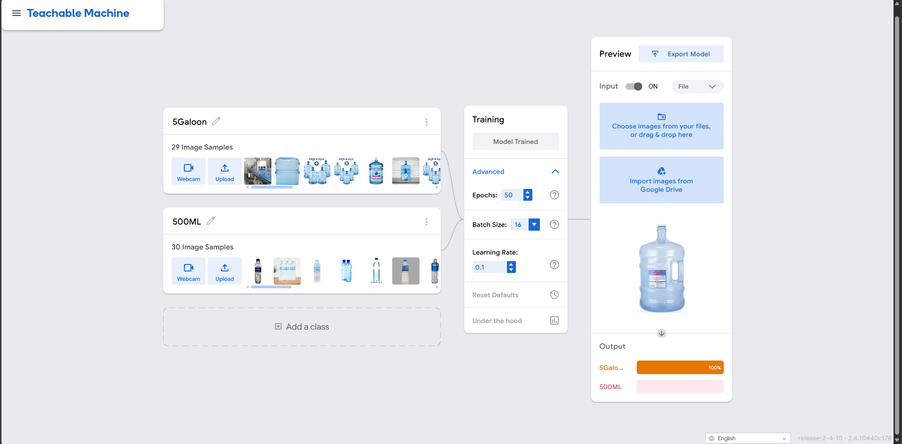

# Water Bottle Classification using Teachable Machine 🧠💧

This project uses Google's [Teachable Machine](https://teachablemachine.withgoogle.com/) to classify water bottle types based on images. Specifically, the model differentiates between **5 Gallon water bottles** and **500ml water bottles**.

## 📸 Classes

| Class Name | Description               | Image Count |
|------------|---------------------------|--------------|
| `5Gallon`  | Large refillable bottles  | 29 images    |
| `500ML`    | Small disposable bottles  | 30 images    |

---

## 🧠 Model Details

- **Platform**: Teachable Machine (Image Project - Standard)
- **Model Type**: Image Classification
- **Training Configuration**:
  - **Epochs**: 50
  - **Batch Size**: 16
  - **Learning Rate**: 0.1
- **Input Type**: Image upload
- **Output**: Label with probability score

---

## 📦 Export Options

You can export the model in multiple formats, such as:
- TensorFlow (for web or mobile)
- TensorFlow.js
- TensorFlow Lite
- Upload to Google Drive

---

## 🖼️ Sample Output

On testing with a 5-gallon image, the model predicted:

-5Gallon: 100%
-500ML: 0%

---

## 🛠 How to Use

1. Visit [Teachable Machine](https://teachablemachine.withgoogle.com/)
2. Click on "Get Started" → "Image Project"
3. Upload images in two classes: `5Gallon` and `500ML`
4. Set training parameters:
   - Epochs: 50
   - Batch Size: 16
   - Learning Rate: 0.1
5. Train the model
6. Export or test the model directly from the browser

---

## 🚀 Applications

This model can be embedded in:
- Quality control systems in bottling factories
- Object counters on assembly lines
- Smart kiosks to identify customer bottle types
- Automated inventory monitoring systems

---

## 📝 Future Improvements

- Add more classes (e.g., 1.5L, 330ml)
- Increase dataset size for better generalization
- Improve background variation and lighting consistency
- Deploy the model to a Raspberry Pi or edge device

---

## 🧑‍💻 Author

**Mohammed Alawfi**  

📍 Madinah, Saudi Arabia

---

## 📄 License

This project is licensed under the [MIT License](LICENSE).

